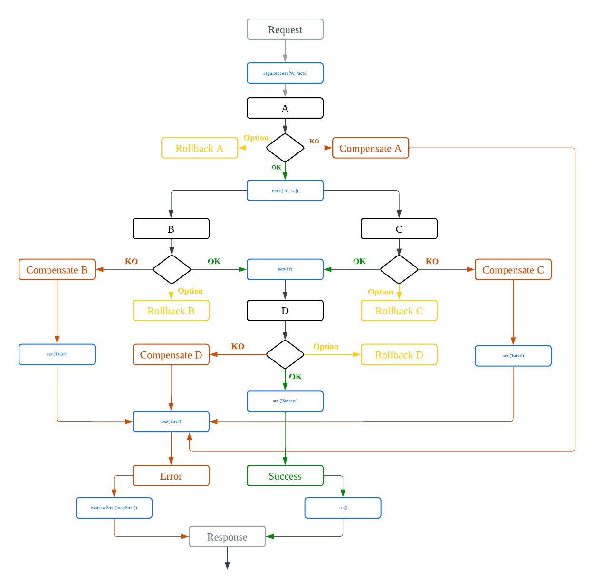

# Drumset

The `drumset` package provides a robust and user-friendly framework for managing complex workflows using the saga pattern.
This pattern is particularly useful for handling distributed transactions by defining a sequence of steps (nodes)
and the logic for compensating (undoing) steps when failures occur. By defining saga's nodes and their relationships,
you can ensure reliable and consistent transaction processing, even in the presence of failures.

```shell

npm i -s drumset

```

Creates a new instance of the `Saga` class.

```javascript
import { Saga } from 'drumset';

const saga = new Saga({
  verbose: true,
  logger: console,
  storage, // optional, see "Persistence"
});
```

Options:

- `verbose` (boolean, default `false`): log scaling, shutdown and finished facts.
- `logger` (object with `log`, default `console`).
- `storage` (`FactStorage`, optional): saves unfinished facts on shutdown and loads them in `restore()`.
- `handleSignals` (boolean, default `true` when `storage` is set): save on SIGTERM / SIGINT / SIGHUP and when the event loop drains.
- `shutdownTimeout` (number, ms, default `10000`): how long `shutdown()` waits for running handlers before saving anyway.

### Saga instance methods:

#### `addNode(name, handler, meta, scaling): void`

Adds a node to the saga.

- **Parameters:**
  - `name` (string): The name of the node.
  - `handler` (function): An asynchronous function that performs the node's operation. The function receives the following arguments:
    - `facts` (object): The current state of the saga.
    - `next` (function): A function to call the next node.
    - `exit` (function): A function to complete the saga or terminate it with an error e.g. exit(new Error('somethingWentWrong')), if if you reach your pivot point you can exit with nodes which you want to run after the result returning. e.g. exit(['node1', 'node2']).
    - `retry` (function): A function to retry processing of the facts on the current node.
    - `error` (Error, optional): An error that caused first.
  - `meta` (object, optional): Additional processing options for the node.
    - `retriesLimit` (number, default 1): How many times the node is retried after its first attempt (so `2` means up to 3 runs).
    - `timeoutBetweenRetries` (number): The time in milliseconds to wait between retries.
    - `rollbackWhenErrorNode` (string): The name of the node to call for compensation if this node fails.
    - `rollbackWhenSuccessNode` (string): The name of the node to call for rollback if this node succeeded but something went wrong in the execution chain after.
    - `runAfterNodesSucceed` (string[]): An array of node names that must succeed before this node will start.
    - `ttl`, `expireAfter`, `executeAfter` (number): Defaults for facts started at this node, used when `process()`
      doesn't pass them (see `process`). `expireAfter` and `executeAfter` are absolute timestamps, so they are fixed when
      `addNode` runs; `ttl` is relative to each fact.
  - `scaling` (object, optional): Additional processing options for the node:
    - `minNodes`: The min count of concurrent nodes that use one queue.
    - `maxNodes`: The max count of concurrent nodes that use one queue. This determines how many instances of this node can run concurrently.
    - `queueSizeScalingThreshold`: threshold of the queue size to run the horizontal scaling

#### `addMiddleware(names, handlers): void`

- **Parameters:**
  - `names` (string): An array of names of the nodes to which middlewares should be applied.
  - `handler` (function): An array of the asynchronous functions, each function receives the following arguments:
    - `facts` (object): The current state of the saga.
    - `next` (function): A function to call the next node.
    - `exit` (function): A function to complete the saga or terminate it with an error.

#### `process(startNode, facts, factsMeta): Promise<facts>`

Starts the saga from the specified node.

- **Parameters:**
  - `startNode` (string, required): The name of the node to start the saga.
  - `facts` (object, required): The initial state of the saga.
  - `factsMeta` (object, optional): Initial meta specific for current facts
    - `executeAfter` (number): The timestamp in milliseconds after which fact processing should start.
    - `expireAfter` (number): The timestamp in milliseconds when facts should be expired and execution chain should be stopped.
    - `ttl` (number): Time to live in milliseconds from now (the earlier of `ttl` and `expireAfter` wins).
    - `retriesLimit` (number): Retries for the start node, and the default for nodes that don't set their own.
    - Each of `ttl`, `expireAfter` and `executeAfter` that isn't passed is taken from the start node's `addNode` meta.
      `retriesLimit` isn't: the start node already uses its own `retriesLimit` when none is passed.
- **Returns:**
  - `Promise`: Resolves with the final state (the same contract you defined for the facts argument) of the saga or rejects with an error.

### Example Usage:

```javascript
const { Saga } = require('drumset');

const calls = [];

const facts = {
  balance: 9,
  amount: 10,
  to: 'a',
  from: 'b',
};

const saga = new Saga();

saga.addNode(
  'A',
  async (facts, next, exit, retry) => {
    console.log(`A executed`);
    calls.push('A');
    next([
      'B',
      'C',
    ]);
  },
  {
    retriesLimit: 1,
    rollbackWhenErrorNode: 'CompensateA',
    rollbackWhenSuccessNode: 'RollbackA',
  },
  {
    minNodes: 1,
    maxNodes: 2,
    queueSizeScalingThreshold: 10,
  },
);

saga.addNode(
  'CompensateA',
  async (facts, next, exit, retry) => {
    console.log(`CompensateA executed`);
    calls.push('CompensateA');
    next('Error');
  },
  {
    retriesLimit: 1,
  },
  {
    minNodes: 1,
    maxNodes: 2,
    queueSizeScalingThreshold: 5,
  },
);

saga.addNode(
  'RollbackA',
  async (facts, next, exit, retry) => {
    console.log(`RollbackA executed`);
    calls.push('RollbackA');
  },
  {
    retriesLimit: 1,
  },
  {
    minNodes: 1,
    maxNodes: 2,
    queueSizeScalingThreshold: 5,
  },
);

saga.addNode(
  'B',
  async (facts, next, exit, retry) => {
    await new Promise((resolve) => setTimeout(resolve, Math.round(Math.random() * 1000)));
    console.log(`B executed`);
    calls.push('B');
    // throw new Error('WTF something went wrong');
    next('D');
  },
  {
    retriesLimit: 2,
    rollbackWhenErrorNode: 'CompensateB',
    rollbackWhenSuccessNode: 'RollbackB',
  },
  {
    minNodes: 1,
    maxNodes: 2,
    queueSizeScalingThreshold: 5,
  },
);

saga.addNode(
  'CompensateB',
  async (facts, next, exit, retry) => {
    console.log(`CompensateB executed`);
    calls.push('CompensateB');
    next('Error');
  },
  {
    retriesLimit: 1,
  },
  {
    minNodes: 1,
    maxNodes: 2,
    queueSizeScalingThreshold: 5,
  },
);

saga.addNode(
  'RollbackB',
  async (facts, next, exit, retry) => {
    console.log(`RollbackBexecuted`);
    calls.push('RollbackB');
  },
  {
    retriesLimit: 1,
  },
  {
    minNodes: 1,
    maxNodes: 2,
    queueSizeScalingThreshold: 5,
  },
);

saga.addNode(
  'C',
  async (facts, next, exit, retry) => {
    console.log(`C executed`);
    // Move an error throwing to another node to check result
    throw new Error('stop');
    calls.push('C');
    next('D');
  },
  {
    retriesLimit: 1,
    rollbackWhenErrorNode: 'CompensateC',
    rollbackWhenSuccessNode: 'RollbackC',
  },
  {
    minNodes: 1,
    maxNodes: 2,
    queueSizeScalingThreshold: 5,
  },
);
saga.addNode(
  'D',
  async (facts, next, exit, retry) => {
    console.log(`D executed`);
    calls.push('D');
    next('Success');
  },
  {
    retriesLimit: 1,
    rollbackWhenErrorNode: 'CompensateD',
    rollbackWhenSuccessNode: 'RollbackD',
    runAfterNodesSucceed: [
      'B',
      'C',
    ],
  },
  {
    minNodes: 2,
    maxNodes: 4,
    queueSizeScalingThreshold: 5,
  },
);

saga.addNode(
  'CompensateC',
  async (facts, next, exit, retry) => {
    console.log(`CompensateC executed`);
    calls.push('CompensateC');
    next('Error');
  },
  {
    retriesLimit: 3,
  },
  {
    minNodes: 1,
    maxNodes: 2,
    queueSizeScalingThreshold: 5,
  },
);

saga.addNode(
  'CompensateD',
  async (facts, next, exit, retry) => {
    console.log(`CompensateD executed`);
    calls.push('CompensateD');
    next('Error');
  },
  {
    retriesLimit: 3,
  },
  {
    minNodes: 1,
    maxNodes: 2,
    queueSizeScalingThreshold: 5,
  },
);

saga.addNode(
  'RollbackC',
  async (facts, next, exit, retry) => {
    await new Promise((resolve) => setTimeout(resolve, Math.round(Math.random() * 2000)));
    console.log(`RollbackC executed`);
    calls.push('RollbackC');
  },
  {
    retriesLimit: 1,
  },
  {
    minNodes: 1,
    maxNodes: 2,
    queueSizeScalingThreshold: 5,
  },
);

saga.addNode(
  'RollbackD',
  async (facts, next, exit, retry) => {
    await new Promise((resolve) => setTimeout(resolve, Math.round(Math.random() * 2000)));
    console.log(`RollbackD executed`);
    calls.push('RollbackD');
  },
  {
    retriesLimit: 1,
  },
  {
    minNodes: 1,
    maxNodes: 2,
    queueSizeScalingThreshold: 5,
  },
);

saga.addNode(
  'Error',
  async (facts, next, exit, retry, error) => {
    console.log(`Error executed`);
    calls.push('Error');
    exit(error);
  },
  {
    retriesLimit: 2,
    timeoutBetweenRetries: 1000,
  },
  {
    minNodes: 1,
    maxNodes: 5,
    queueSizeScalingThreshold: 10,
  },
);

saga.addNode(
  'Success',
  async (facts, next, exit) => {
    console.log(`Success executed`);
    calls.push('Success');
    exit();
  },
  { retriesLimit: 1 },
  {
    minNodes: 1,
    maxNodes: 2,
    queueSizeScalingThreshold: 5,
  },
);

setTimeout(() => {
  // Take a look behind the scenes to check all running nodes
  console.log(calls);
}, 10000);

saga
  .process('A', facts)
  .then((result) => {
    console.log({ result });
  })
  .catch((error) => console.log({ error }))
  .finally(() => {
    // Take a look what nodes were running when you receive reply
    console.log(calls);
  });
```

### Facts

Every call of `process` creates a fact: `{ id, meta, data }`. `data` is your object; `meta` describes
the execution and is plain JSON:

```typescript
import { Fact, FactMeta, NodeExecution } from 'drumset';

type Fact<DataType, NodeName extends string> = {
  id: string;
  meta: FactMeta<NodeName>;
  data: DataType;
};
```

`meta` holds:

- `status`: `pending`, `running`, `completed`, `failed` or `expired`
- `startNode`, `currentNode` (started most recently), `activeNodes` (queued, running, waiting or retrying now), `path` (order nodes first ran in)
- `createdAt`, `updatedAt`, `finishedAt`, `durationMs`, `ttl`, `expiresAt`, `executeAfter`, `maxRetries`, `error`
- `nodes`: per node `status`, `attempts`, `retries` / `maxRetries`, `retryDelay`, `enqueuedAt`, `startedAt`, `finishedAt`,
  `durationMs` (last attempt), `totalDurationMs`, `nextAttemptAt`, `waitingFor` and every error with its attempt and time
- `flow`: the saga's control state (processed, failed, rollbacks, compensators, after-exit nodes) used to resume a fact

Finished facts are emitted as events:

```javascript
saga.on('completed', (fact) => console.log(fact.meta.durationMs));
saga.on('failed', (fact, error) => console.log(fact.meta.nodes));
```

### Persistence

Give the saga a storage with two async methods. Where the facts go is up to you:

```javascript
const fs = require('fs/promises');

const storage = {
  async load() {
    return JSON.parse(await fs.readFile('facts.json', 'utf8').catch(() => '[]'));
  },
  async save(facts) {
    await fs.writeFile('facts.json', JSON.stringify(facts));
  },
};

const saga = new Saga({ storage });
// ...addNode calls...
await saga.restore(); // resumes facts saved by the previous process
```

- `saga.shutdown()` stops taking new work, waits for running handlers (up to `shutdownTimeout`) and calls
  `storage.save` with every unfinished fact. Pending retries and delays are saved with their `nextAttemptAt` and resumed on time.
- `Saga.terminate()` shuts down every saga.
- With `handleSignals` (default when `storage` is set), SIGTERM, SIGINT and SIGHUP trigger the shutdown, then the process exits
  as it normally would for that signal. If your application listens to the signal itself, it decides when to exit.
  A second signal during the shutdown exits immediately. When the event loop drains, unfinished facts are saved too.
- `process.exit()` can't wait for async work: call `await Saga.terminate()` before it.
- A node that was running at shutdown runs again after `restore()`, so handlers should be idempotent.
- `restore()` keeps facts that reference nodes the saga doesn't have, and saves them again instead of dropping them.
- `saga.snapshot()` returns the unfinished facts at any time.

### Middlewares

```typescript
saga.addMiddleware(
  [
    'A',
    'D',
  ],
  [
    async (facts) => {
      console.log(`Middleware executed`);
    },
  ],
);
```

A middleware that calls `next` or `exit` ends the node: the following middlewares and the handler don't run.

### Node Definitions

Here we have the next nodes:

- A: our saga`s entry point
- RollbackA: rollbacks succeeded A if something went wrong in the execution chain after that
- CompensateA: rollbacks failed A and goes to the Error node
- B: is executing simultaneously with node C
- C: is executing simultaneously with node B
- RollbackB: the same as RollbackA but for the node B
- CompensateB: the same as CompensateA but for the node B
- RollbackC: ...
- CompensateC: ...
- D: run if B and C nodes both succeeded
- RollbackD: ...
- CompensateD: ...
- Error: prepare and returns error response
- Success: prepare and returns success response

### Our saga`s graph



#### [Sandbox](sandbox/example.js)

#### [Changelog](./CHANGELOG.md)
